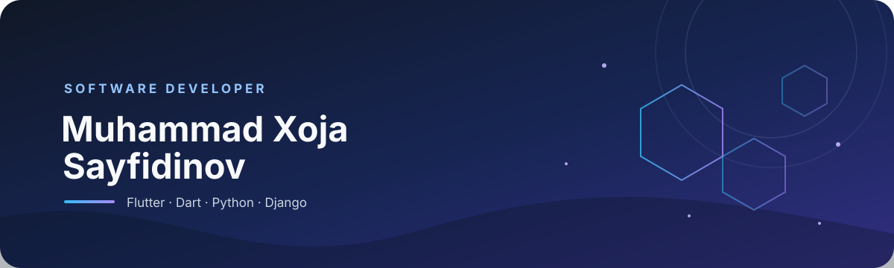

  

<h1 align="center">Hi, I'm Muhammad Xoja 👋</h1>

  <strong>Software developer building mobile experiences and practical web solutions.</strong> 
  I work with Flutter and Dart, and explore Python and Django to build across the stack.

  
  

## About me

- 📱 Building cross-platform apps with **Flutter** and **Dart**
- 🐍 Working with **Python** and **Django** for backend and web development
- 🧩 Interested in clean, useful products that solve real-world problems
- 🌱 Always learning and improving through hands-on projects

## Tech stack

  
  
  
  

## Featured projects

- **[Dilkash](https://github.com/muhammadxoja-sayfidinov/dilkash)** — A broad Flutter and Django restaurant ecosystem, including customer and staff apps and a backend/POS. This is the strongest candidate to feature based on its detailed project documentation.
- **[Neoplay](https://github.com/muhammadxoja-sayfidinov/neoplay)** — A Dart project that could complement a mobile-focused profile; consider pinning if its README and current state are polished.
- **[Qarzdorlikbot](https://github.com/muhammadxoja-sayfidinov/qarzdorlikbot)** — A Python project that could showcase your Python work; review the repository description and documentation before pinning.

**Pin recommendation:** Start with `dilkash`. Add `neoplay` and `qarzdorlikbot` only if they represent finished, presentable work. I reviewed repository metadata and available READMEs, not every codebase, so validate those two candidates before pinning.

## GitHub at a glance

  
  

  

  

---

Thanks for stopping by — feel free to explore my repositories and connect through GitHub.

